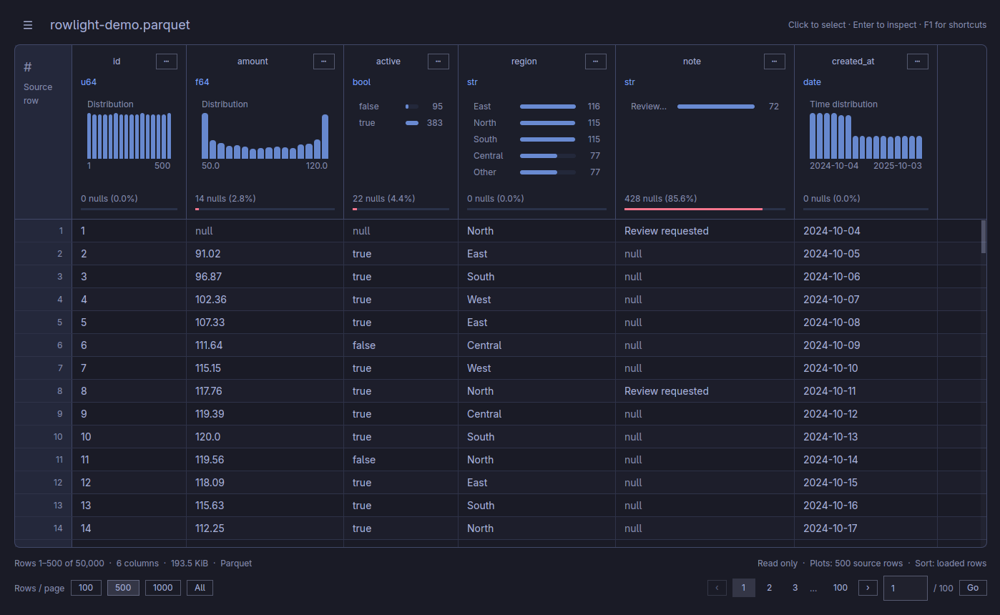
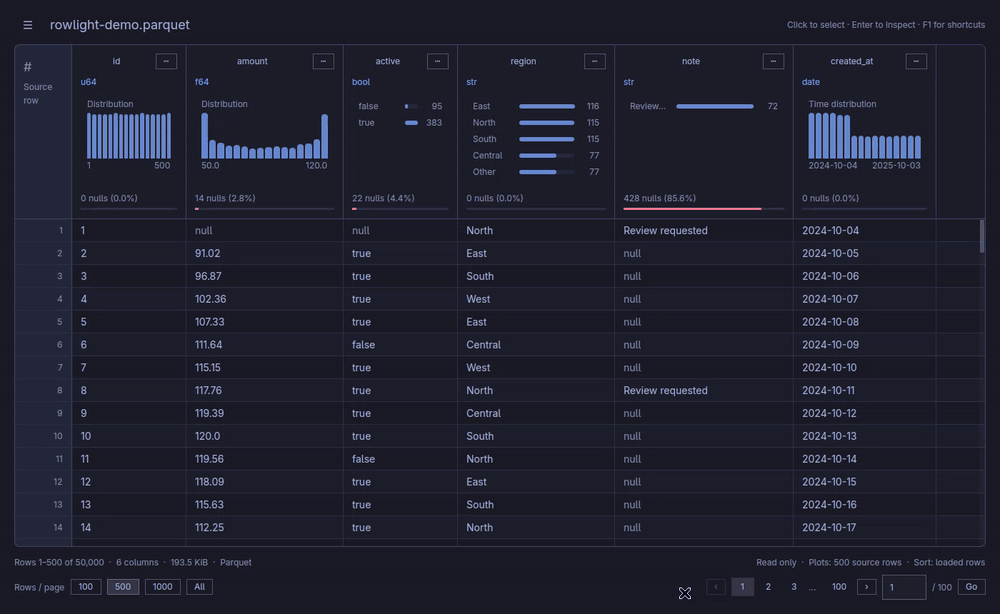
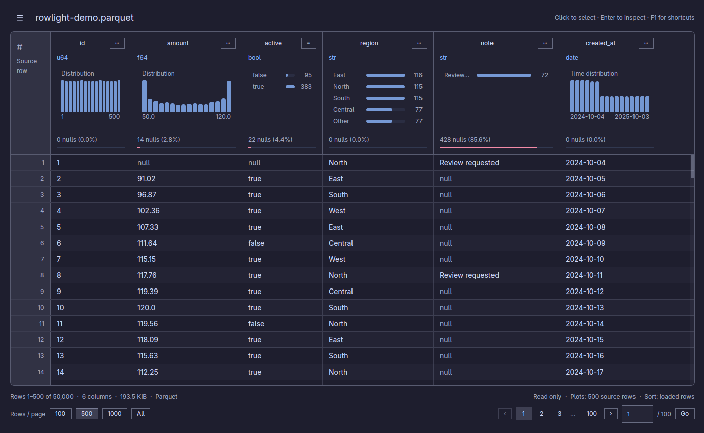
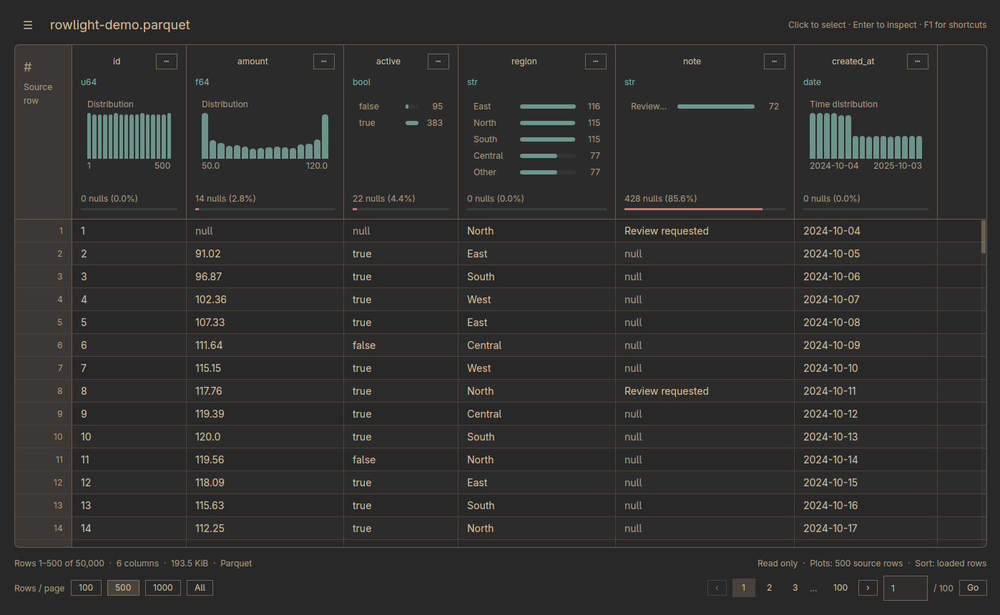
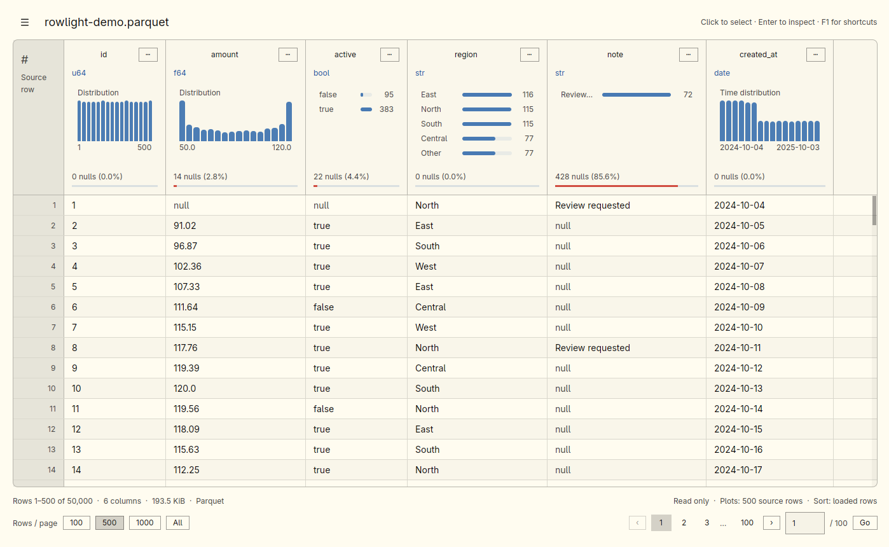

<p align="center">
  <picture>
    <source media="(prefers-color-scheme: dark)" srcset="docs/assets/logo-dark.svg">
    <source media="(prefers-color-scheme: light)" srcset="docs/assets/logo-light.svg">
    
  </picture>
</p>

<h3 align="center">Bringing data into view.</h3>
<p align="center">Easy to pronounce and works across formats.</p>

<p align="center">
  A small, read-only desktop viewer for Parquet, Arrow IPC / Feather, CSV, and TSV.<br>
  Built with Rust, GPUI Kit, and Polars. Targets Linux, Windows, and macOS.
</p>

<p align="center">
  <a href="docs/user-guide.md">User guide</a> ·
  <a href="docs/development.md">Development</a> ·
  <a href="LICENSE">MIT license</a>
</p>



## A quick look



Open a file, see its schema and distributions, and explore without changing the data.

- **See the shape:** column types, nulls, distributions, and expanded charts.
- **Explore:** sort the loaded page, filter the file, find columns, and inspect cells.
- **Keep it light:** paged reads, virtual scrolling, and guarded All mode.
- **Pick up where you left off:** saved view settings and keyboard navigation.

Plots summarize the displayed rows; **File overview** provides a bounded sample across the file. Optional cloud builds open remote Parquet from S3, Azure, GCS, and HTTP(S).

## Your Omarchy theme

Rowlight follows the current Omarchy palette, including live theme changes. These are captures of the same synthetic file in the running Linux app.

| Tokyo Night | Catppuccin |
| :---: | :---: |
| [](docs/assets/tokyo-night.png) | [](docs/assets/catppuccin.png) |
| **Gruvbox** | **Flexoki Light** |
| [](docs/assets/gruvbox.png) | [](docs/assets/flexoki-light.png) |

## Try it

With Rust and the [native prerequisites](https://gpui-kit.com/docs/installation/) installed:

```sh
cargo dev -- /path/to/file.parquet
```

[Build and install](docs/user-guide.md#double-click-opening-on-linux) · [Windows](docs/user-guide.md#windows) · [macOS](docs/user-guide.md#macos) · [All features and shortcuts](docs/user-guide.md#use)

Inspired by the concise project introductions in [Lapce](https://github.com/lapce/lapce) and [Zed](https://github.com/zed-industries/zed). Media uses synthetic data; [capture details](docs/media.md).
