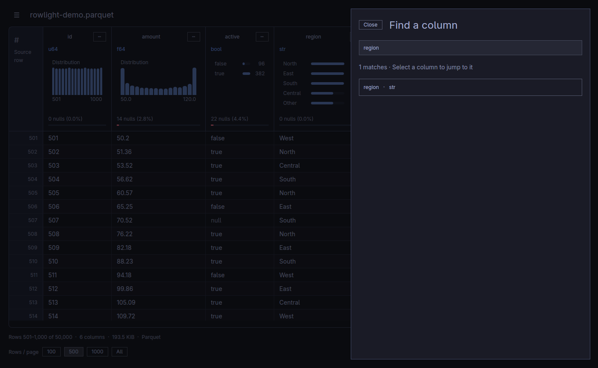
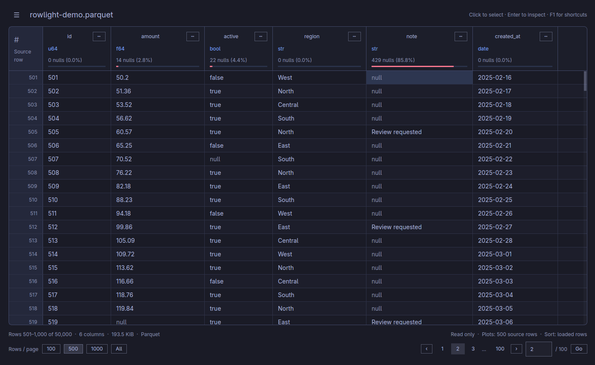
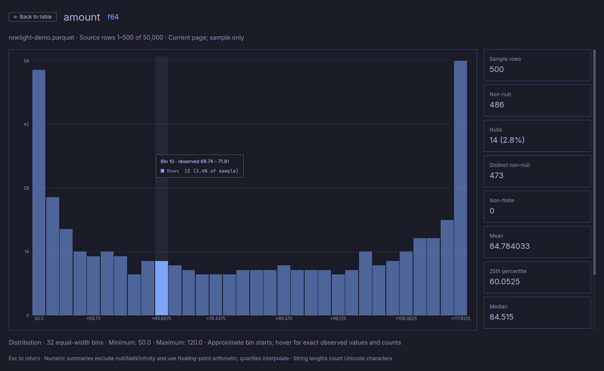
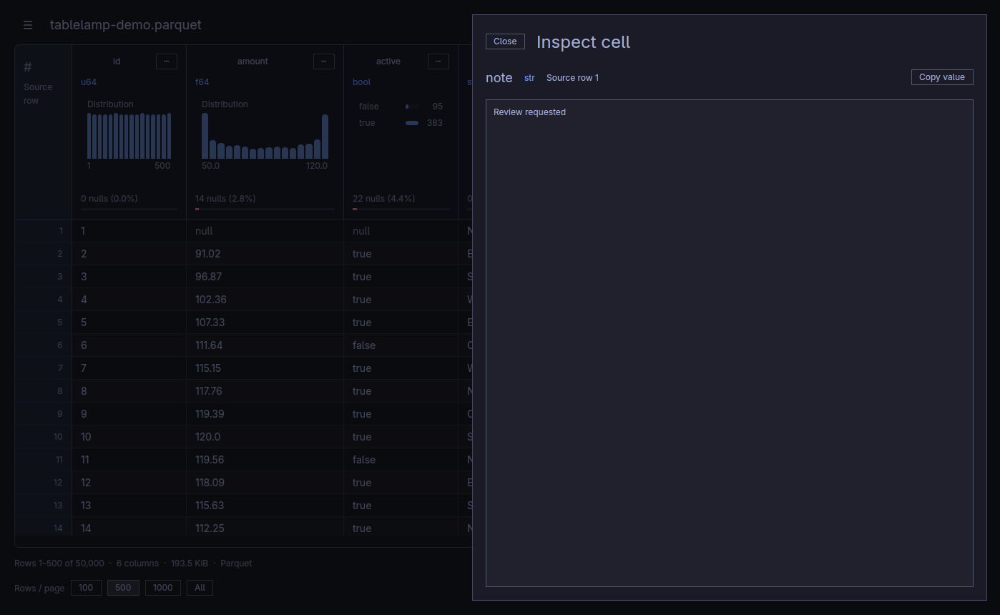

# Rowlight user guide

Open a file, understand its columns, and explore its rows. Rowlight is read only: sorting, filtering, and copying leave your source file unchanged.

[Install Rowlight](installation.md) · [Supported formats](formats.md) · [Keyboard shortcuts](keyboard-shortcuts.md) · [Back to the project](../README.md)

## Start here

1. **Open a file.** Choose **Open file…** from the top-left menu, press **Ctrl+O** (**Cmd+O** on macOS), or drop a file onto the window.
2. **Look at the headers.** Each column shows its name, data type, null count, and a small distribution chart when its type supports one.
3. **Explore a column.** Click its chart for a larger view and statistics. Press **Esc** to return.
4. **Browse the rows.** Scroll vertically and use the pagination controls at the bottom to load another page.

> [!NOTE]
> Header charts describe the current page. For a broader view, choose **File overview…** from the menu; it samples across the file. Neither view promises exact whole-file statistics for a large file.

## Find your way around

| I want to… | Go to |
| --- | --- |
| Move through a large file or sort rows | [Browse and sort](#browse-and-sort) |
| Find, resize, or hide a column | [Focus on the columns you need](#focus-on-the-columns-you-need) |
| Understand a distribution or see file metadata | [Understand the data](#understand-the-data) |
| Read a long value or copy a selection | [Inspect and copy cells](#inspect-and-copy-cells) |
| Show only matching rows | [Filter the file](#filter-the-file) |
| Keep my view and follow my desktop theme | [Make the view your own](#make-the-view-your-own) |
| Fix a loading or display problem | [Troubleshooting](#troubleshooting) |

## Browse and sort

The shaded **# / Source row** gutter shows each row's original position in the file. It is separate from the file's data columns and stays attached to the same record after sorting or filtering.

Missing values appear as muted, italic `null`; empty text appears as **(empty string)** in the accent color. NaN and infinity use the warning color. These labels distinguish the values without changing them.

### Move through rows and pages

The mouse wheel scrolls rows. Use a horizontal gesture or the bottom horizontal scrollbar to move through a wide table. Headers and cells move together.

The status bar shows the source information, displayed row range, and pagination. Choose **100**, **500**, or **1,000** under **Rows / page**. Use the page buttons, or press **Ctrl+G** (**Cmd+G**), enter a page number, and press **Enter**.

**Home / End** goes to the first / last row of the loaded page. **Ctrl+Home / End** (**Cmd+Home / End**) goes to the beginning / end of the file. **Alt+Left / Right** loads the previous / next page. See the [complete shortcut reference](keyboard-shortcuts.md) for selection and screen navigation.

### Sort a column

Click a column name to cycle through **ascending → descending → source order**. Nulls sort last. Sorting applies to the **loaded page**; in **All** mode it applies to all loaded rows. With filters active, it sorts the loaded matching page.

### Show all rows

Choose **All** under **Rows / page** to load the complete file when it fits the memory budget. If Rowlight declines the load, choose a paged size and keep browsing. This choice is remembered, and the memory check runs again for every file.

For very large files, start with **100** or **500**. The [large-file reference](formats.md#large-files-and-memory) explains the limits, including why a small compressed file can still need substantial memory.

## Focus on the columns you need

Columns always follow the order stored in the file.

| Task | Action |
| --- | --- |
| Jump to a column | Press **Ctrl+F** (**Cmd+F**), search by name or type, and select a result. |
| Choose visible columns | Menu → **Show / hide columns…**; use the checkboxes. Keep at least one visible. |
| Hide one column | Its **⋯** menu → **Hide column**. |
| Restore every column | **Show / hide columns…** → **Show all**. |
| Resize a column | Drag the right edge of its header. |
| Fit its displayed values | Double-click that edge, or **⋯ → Fit visible values**. |
| Use compact headers | Turn off **Show column plots** in the top-left menu. Names, types, and null information remain visible. |

Widths are remembered per file and stay between 120 and 800 pixels. **Fit visible values** measures the header and up to 40 displayed values; use the inspector for content that still does not fit.

See column search and compact headers

## Understand the data

### Explore a column

Click a chart, or use **⋯ → Column details…**. The column fills the existing app window with a larger chart and a scrollable statistics panel. Hover over bars to see their counts, percentages, and observed values. Use **Back to table** or **Esc** to return; the app does not change the window's fullscreen state.

| Column type | What you see |
| --- | --- |
| Numbers | Histogram, range, mean, median, quartiles, and sample standard deviation |
| Dates, timestamps, time, durations | Chronological histogram with typed values |
| Booleans | False / true frequency bars and percentages among non-null values |
| Text, categorical, enum | Frequent values; text also includes empty-string counts and character lengths |
| Binary or nested values | Type and null information; use the cell inspector to explore individual values |

Nulls are counted separately. Numeric calculations exclude NaN and infinity. All-null columns have no distribution chart.

Type labels reflect the file's Polars schema: for example, `str` is text, `f64` is a floating-point number, `i64` is a signed integer, and `bool` is true/false.

**The scope matters:** page charts use the loaded rows, capped at the first **1,000** in All mode. Expanding a chart reuses that same sample. Sorting does not change it. Distinct counts are exact within the sample; they are not the file's total number of distinct values. See [chart and statistics details](formats.md#charts-and-statistics) for precision and sampling limits.

### Get a broader file overview

Choose **File overview…** from the menu. Rowlight reads up to **1,000 rows** across **16 evenly spaced windows**, including the beginning and end of a larger file. The overview shows sampled null percentages, distinct values, ranges or frequent categories, and expandable charts. Files with at most 1,000 rows are summarized completely.

The overview runs in the background and can be cancelled. Its sample describes the **unfiltered source**, even while the table has active filters. An evenly spaced sample can miss rare values or patterns; use it to orient yourself, not as an exact whole-file report.

### See the file's metadata

Choose **File details…** for the full source path, size, and complete schema in file order. Parquet details include its writer, compression, encodings, and row-group sizes; IPC details include record batches. This view uses metadata already read when opening the file.

## Inspect and copy cells

Click a cell to select it. Use the arrow keys to move, or **Shift+click / Shift+arrows** to extend a rectangular selection. Click a source-row number to select its entire row.

Double-click a cell, or select it and press **Enter**, to open the inspector. It shows the value, data type, and original source row. This is useful for long text, binary data, and nested values. Use **Copy value** to copy the inspector's text, then **Esc** to return.

See the cell inspector

| Copy action | Result |
| --- | --- |
| **Ctrl+C** (**Cmd+C**) | Selected cells; a multi-cell selection is tab-separated text. |
| **Ctrl+Shift+C** (**Cmd+Shift+C**) | Selected rows with visible column names, in displayed order. |
| **Ctrl+A** (**Cmd+A**) | Select all loaded rows and visible columns before copying. |

Copying is limited to **10,000 cells** and **1 MiB**. Nulls copy as `null`; empty strings copy as empty fields. Multi-cell output quotes tabs, newlines, and quotes; a single cell copies its raw value. Binary values use hexadecimal.

Table previews show up to 256 characters. The inspector shows up to 65,536 characters and 32 nesting levels, with a notice when truncated. In that case **Copy displayed text** copies only what the inspector shows. Grid copying rejects an oversized cell instead of silently shortening it.

## Filter the file

1. Open a column's **⋯ → Filter…** menu.
2. Choose a condition and enter a value when needed.
3. Select **Apply filter**. Follow the scan progress in the status bar.

For example, use **Contains** on a text column to find a case-sensitive substring, **Between (inclusive)** on a number column to select a range, or **Is null** to find missing values. Boolean filters offer **True / False**. Use **Equals** with an empty text value to find empty strings.

Filters apply to the **whole file**. Up to eight filters on different columns combine with **AND**, so a row must match all of them. After the scan, pagination shows the exact matching row count. Remove an individual filter chip or choose **Clear all** above the table to restore the unfiltered view.

Scanning runs in the background; **Cancel** keeps the prior view. Large or remote files can take time and require substantial reads. The results keep their original source row numbers, and page charts describe the loaded matches. See [filter formats and limits](formats.md#filters) for date/time inputs and memory behavior.

## Make the view your own

Rowlight saves page size, plot visibility, the association-prompt decision, and window dimensions automatically. For the **20 most recent sources**, it also remembers the page, sorting, column widths and visibility, filters, and scroll position. CSV/TSV options and the selected AWS profile are saved too. Reopening a remembered source restores its view; saved filters are scanned again.

Use **Recent files…** to return to a source. **Clear history** removes remembered sources and their saved views; the current source stays out of history until you open another one. Starting the app without a file does not automatically reopen the last source.

On Omarchy, Rowlight follows the current palette, including changes while it runs. Without a usable Omarchy theme, it uses Tokyo Night, including on Windows and macOS. It does not modify your desktop theme. See the [theme gallery](../README.md#your-omarchy-theme).

Where preferences live

| Platform | File |
| --- | --- |
| Linux | `${XDG_CONFIG_HOME:-~/.config}/parquetviewer/settings.json` |
| Windows | `%APPDATA%\parquetviewer\settings.json` |
| macOS | `~/Library/Application Support/parquetviewer/settings.json` |

Close the app before backing up or resetting this file. Renaming it lets Rowlight start with defaults while preserving your backup. Settings use atomic replacement; invalid or older settings fall back to validated defaults. Resize and scroll updates are flushed on close. Fullscreen/maximized dimensions do not replace the remembered window size; your window manager controls placement.

Non-UTF-8 local paths still open but cannot be saved in JSON history. URLs with a query or fragment, including signed URLs, are excluded from history and saved views.

Omarchy's current palette is read from `~/.local/state/omarchy/current/theme/colors.toml` and `theme.name`, with a legacy config-directory fallback.

## Troubleshooting

| What happened? | What to try |
| --- | --- |
| Double-click opens another application | Choose **Associate Parquet files…** from the menu, or follow the [platform association steps](installation.md). |
| **All** is rejected | Select **100**, **500**, or **1,000** rows per page. The memory guard also runs when a remembered All preference is restored. |
| A CSV has the wrong columns or fails on a later page | Set its delimiter/header in **CSV / TSV options…**. For mixed types, choose **Read all columns as text** and **Save and apply**. |
| CSV reports invalid UTF-8 | Convert it to UTF-8, or explicitly choose replacement decoding in **CSV / TSV options…**. Other encodings are not automatically detected. |
| A chart is absent | Binary, nested, and all-null columns have no distribution plot. Very large sample values can also cause chart/statistics calculations to be skipped with an explanation. |
| The table's chart counts differ from the overview | The table summarizes its loaded page; the overview samples across the unfiltered file. Check each view's scope label. |
| A remote source will not open | Check that you have a cloud build, usable provider credentials, and a server supporting ranges and object-version checks. See [remote Parquet](formats.md#remote-parquet). |
| The source changed while browsing | Reopen it to refresh metadata and the remote cache. Incompatible saved filters are cleared with a notice. |

For a reproducible problem, [open an issue](https://github.com/EtienneT/rowlight/issues) with your OS, build version, format, steps, and error message. A small synthetic example is helpful; omit private data and credentials.

---

[Installation](installation.md) · [Formats and reading behavior](formats.md) · [All shortcuts](keyboard-shortcuts.md) · [Development](development.md)
